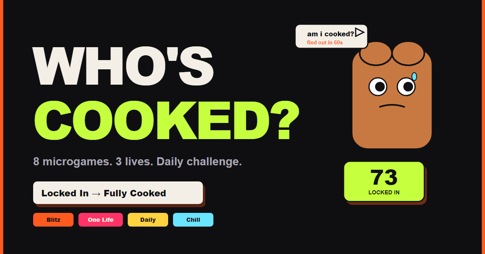

# Who's Cooked?

> **8 microgames. 3 lives. Find out if you're locked in — or cooked.**

A mobile-first browser game built for Gen Z. Players race through 8 fast microgames, earn a score, and can duel friends on the exact same run via a shareable link — no install required.

**Live demo →** https://whoscooked.whoscooked-api.workers.dev



---

## Features

| Feature | Detail |
|---|---|
| **6 game modes** | Classic, Blitz (60s), One Life, Chill, Daily, Duel |
| **8 microgames** | Pop, Flags, Don't, Order, Burnt, Mash, Catch, Count |
| **Progression** | XP, levels 1–∞, slang titles, the Cooked Crew roster |
| **Daily challenge** | Same seed for every player every day, shareable grid |
| **Duel system** | Ghost encoded in the URL — friend plays your exact run |
| **Leaderboards** | Daily boards with generated handles, 30-day auto-prune |
| **Monetisation** | Cooked+ $3.99 and Chaos Crew $1.99, one-time (no subscriptions, no loot boxes) |
| **Age-safe** | Under-13s blocked from purchases and leaderboard posting |
| **Break prompts** | Player offered a break every 10 runs |

---

## Tech stack

```
Frontend         Astro 7 (static) + React 19 islands (client:only)
Game engine      PixiJS 8 (WebGL) — 8 microgames, boss rounds, synthesised sounds
Backend          Hono on Cloudflare Workers (base path /api/v1)
Database         Neon (Postgres 18) via Cloudflare Hyperdrive
ORM              Drizzle — schema-first, migrations in /packages/db/migrations
Payments         Dodo Payments (PaymentProvider adapter, Standard Webhooks HMAC)
Auth             Anonymous player cookie (signed HttpOnly, 400-day max-age)
Fonts            Bricolage Grotesque 700/800 + Atkinson Hyperlegible (self-hosted)
Testing          Vitest (102 unit tests) + Playwright (20 e2e at 360-390 px phone)
CI/CD            GitHub Actions → Cloudflare Workers (API + Web workers)
```

---

## Monorepo layout

```
apps/
  web/          Astro site + React game shell, deployed as Workers static assets
  api/          Hono Worker, all routes under /api/v1
packages/
  game-core/    Seeded RNG, 6 modes, 8 microgame specs, scoring, XP, missions
  game-renderer/PixiJS stage, all microgame renderers, synthesised Web Audio
  brand/        Design tokens, Cooked Crew SVG characters, shared CSS
  db/           Drizzle schema, migrations, commerce + leaderboard queries
  payments/     PaymentProvider interface, Dodo and Fake implementations
  analytics/    Typed PostHog event helpers (on-device until consent)
  i18n/         Paraglide messages and locale tools
  video/        Remotion compositions (share clip)
docs/
  decision.md   Theme and design decisions with rationale
  research.md   Sourced research on Gen Z gaming, monetisation, mascots
  value.md      Honest product value assessment
  deploy.md     Environments, secrets, runbook
```

---

## Architecture

```
Browser
  │
  ├─ /         Static HTML (Astro, zero JS)
  ├─ /play/    React island (client:only) → PixiJS canvas
  │               ├─ runGame()  — microgame loop
  │               ├─ progress   — localStorage XP / streak / missions
  │               └─ sheets     — Hub · Shop · Crew · Leaderboard
  │
  └─ /api/*    Cloudflare Worker service binding (same origin)
                  ├─ GET  /leaderboard   — top 50 + your row
                  ├─ POST /scores        — ghost-verified score
                  ├─ POST /checkout      — Dodo Payments
                  └─ POST /webhooks/dodo — payment.succeeded / refund.succeeded

Neon Postgres ← Cloudflare Hyperdrive (connection pooling)
  Tables: players · purchases · entitlements · webhook_events
          leaderboard_entries · handles
```

---

## Running locally

```bash
# 1. Install
pnpm install

# 2. Set up the local DB connection (Neon dev branch)
echo "CLOUDFLARE_HYPERDRIVE_LOCAL_CONNECTION_STRING_HYPERDRIVE=<neon-dev-url>" \
  > apps/api/.env.local-db

# 3. Start API (port 8787) + web (port 4321)
pnpm dev

# 4. Open http://localhost:4321
```

The API starts with a fake payment provider, so you can buy Cooked+ end-to-end without real money. The fake checkout lives at `/api/v1/dev/fake-checkout`.

---

## Tests

```bash
pnpm typecheck   # 0 errors
pnpm test        # 102 unit tests
pnpm e2e         # 20 Playwright tests at 360–390 px (phone)
pnpm build       # static + Worker build
```

---

## Deployment

Pushes to `main` deploy both Workers automatically via GitHub Actions once the `CLOUDFLARE_API_TOKEN` and `DATABASE_URL` secrets are set. See [`docs/deploy.md`](docs/deploy.md) for the full runbook.

```bash
# Manual deploy (requires wrangler auth)
pnpm --filter @whoscooked/api deploy
pnpm --filter @whoscooked/web deploy
```

---

## Design system

Dark-first, Gen Z aesthetic: near-black backgrounds, sticker cards with hard heat-orange offset shadows, chunky Bricolage Grotesque headings, acid-green scores. The Cooked Crew — 11 original slang-archetype characters — are pure SVG components driven by `who`, `mood`, `size`, and `lookX/lookY` props.

Color palette:

| Token | Hex | Use |
|---|---|---|
| `bg` | `#0F0F12` | Page background |
| `paper` | `#F4EFE6` | Text on dark, sticker cards |
| `acid` | `#C6FF3D` | Scores, primary actions, "locked in" |
| `heat` | `#FF5A1F` | Brand, "cooked", offset shadows |
| `ice` | `#6BE4FF` | Info, focus rings |
| `danger` | `#FF3366` | Mistakes, destructive actions |

---

## Status

| Item | Status |
|---|---|
| Core gameplay | ✅ Shipped |
| 6 modes | ✅ Shipped |
| Progression (XP, levels, crew) | ✅ Shipped |
| Daily + leaderboards | ✅ Shipped |
| Duel system | ✅ Shipped |
| Real payments | ⏳ Pending Dodo Payments merchant approval |
| Custom domain | ⏳ Pending domain purchase |
| i18n (FR, DE, ES) | ⏳ Backlog |

---

## Disclaimer

Who's Cooked? is a game for fun. It isn't a medical, psychological, or relationship test.
